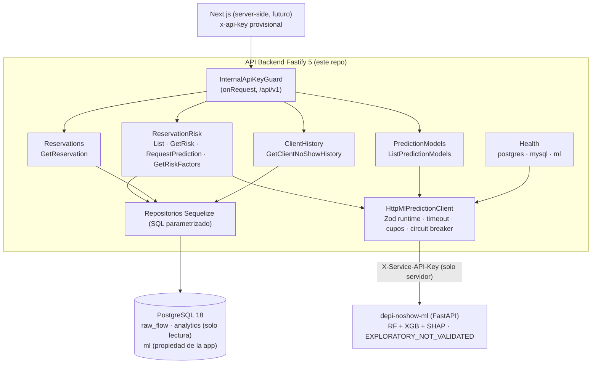

# Sprint 01 — Arquitectura

Estilo **Modular V1**: Screaming Architecture + Vertical Slices
(`Módulo → Feature → application/presentation`). No es una migración a Hexagonal.

## C4 simplificado (componentes del API Backend en este sprint)



## Flujo de una petición (ejemplo HU-02)

```text
POST /api/v1/reservations/:reservationId/predictions
  → RequestReservationPredictionRoute (método, path, schema AJV, bodyLimit)
  → RequestReservationPredictionHandler.handle()   (Request → Input; Result → Response; 201/200)
  → RequestReservationPrediction.execute()
      → ReservationRepository.findById (raw_flow/analytics, READ ONLY)
      → BookingSnapshotResolver (snapshot ml.* | evidencia de la réplica | NOT_SCORABLE)
      → ClientHistoryRepository.summarizeAsOf (known_at < prediction_at)
      → RiskFeaturesBuilder.build → validateFeatureSnapshot → computeSnapshotHash
      → BookingSnapshotRepository.saveIfAbsent (inmutable)
      → CachedMlModelCatalog + PredictionResultRepository.findByIdentities (idempotencia)
      → MlPredictionClient.compare/predict (FUERA de transacciones)
      → PredictionResultRepository.saveRun (transacción corta, UNIQUE)
  → RiskAssessmentHttpMapper → respuesta versionada
```

## Módulos y dependencias (verificadas por `tests/unit/architecture/ModuleBoundaries.test.ts`)

| Módulo                                  | Features                                                                                                                                          | Depende de (solo `Shared/`) |
| --------------------------------------- | ------------------------------------------------------------------------------------------------------------------------------------------------- | --------------------------- |
| `Health` (existente + `CheckMlService`) | CheckPostgresConnection, CheckMysqlConnection, CheckMlService                                                                                     | —                           |
| `FlowMigration` (existente, intacto)    | migración FLOWww                                                                                                                                  | —                           |
| `Reservations`                          | GetReservation; `Shared/` repositorio de reservas, modelos, cursor, schemas HTTP                                                                  | —                           |
| `ClientHistory`                         | GetClientNoShowHistory; `Shared/` repositorio as-of                                                                                               | Reservations                |
| `ReservationRisk`                       | ListReservationRisks, GetReservationRisk, RequestReservationPrediction, GetRiskFactors; `Shared/` builder, validadores, política, persistencia ml | Reservations, ClientHistory |
| `PredictionModels`                      | ListPredictionModels                                                                                                                              | ReservationRisk (política)  |

Reglas automatizadas: `application/` no importa Fastify ni `presentation`; handlers sin SQL ni
`sequelize/pg`; routes sin SQL/fetch/persistencia; sin carpetas globales
`controllers/services/repositories`; ningún test en `src/`; sin imports a features privadas de
otro módulo; grafo de módulos acíclico; `infrastructure/` y `shared/` no dependen de módulos;
sin `sync({alter|force})` ni DDL/escrituras sobre `raw_flow`/`analytics` (excepción documentada:
el cargador FLOWww preexistente); el builder as-of no referencia `client_history_current` ni `target`;
ningún archivo nuevo > 450 líneas (el mayor: `HttpMlPredictionClient.ts`, ~360).

## Composición

- `src/index.ts` → `createPredictiveConfig(Environment)` → `createPredictiveDependencies()` → `buildApp()`.
- `RegisterModules.ts` registra `Health` en `/api` y, solo si hay credencial configurada,
  un contexto encapsulado `/api/v1` con la compuerta y los 4 módulos de negocio.
- Cada `*Module.ts` es el composition root local (repositorios → operaciones → handlers → routes).
- Los tests sustituyen dependencias por dobles (`tests/helpers/BuildTestApp.ts`) sin service locator.

## Archivos existentes modificados (sin reescribir su diseño)

`BuildApp.ts` (request-id validado, `bodyLimit` 64 KiB, cabecera `x-request-id`, inyección),
`RegisterModules.ts`, `index.ts`, `HealthModule.ts` (+ health ML), `EnvironmentSchema.ts`
(variables ML/seguridad/modo), error handler (`NormalizedException`, `NormalizeException`,
`GetHttpStatusFromException`, `GetPublicErrorMessage`, `PinoExceptionReporter`) para 429/502/504.
`Environment.ts` y `Logger.ts`: solo formato Prettier.
